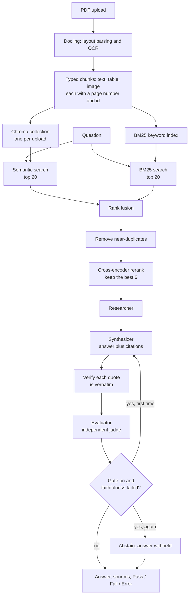

# Document Intelligence POC: Multi-Agent RAG Researcher

A local, stateless proof of concept for asking questions about a PDF and being able to **check the answers**. It parses documents with layout analysis, retrieves with a hybrid keyword and semantic pipeline, answers with citations to the page and quote, grades every answer with an independent judge, and can withhold answers it cannot verify. Everything runs on your machine with Ollama, apart from optional LangSmith tracing.

## Project summary

**What was added to the original prototype**
- **Citations you can check.** Every answer lists the passages it relied on, each with its page number and a quote that code has verified is verbatim text from that passage. Quotes that are not verbatim are dropped.
- **An independent judge.** Answers are graded by a different model from the one that wrote them, and each check is shown as Pass, Fail or Error rather than a percentage.
- **An optional faithfulness gate.** A failed check retries the answer once, then replaces it with an explicit "I can't verify this" message. It is off by default (see Known limitations).
- **Better retrieval.** A larger candidate set, near-duplicate removal, BM25 keyword search merged with semantic search, and a local cross-encoder reranker, all behind one retriever.
- **Visibility.** A panel under every answer shows which chunks were retrieved, and developer tools print what chunking, BM25 and each retrieval stage are doing.
- **Isolation and accuracy fixes.** One vector collection per upload, page numbers on every chunk, and LangSmith feedback that matches what the screen shows.

**Challenges found along the way**
- The model graded its own answers, the scores changed nothing, and answers had no sources.
- Uploading a second PDF mixed it with the first, because all uploads shared one collection.
- Metrics were silently never reaching LangSmith, and an evaluator failure was recorded as a score of 0.
- Retrieval missed answers on real documents: repeated headers and overlapping chunks filled the few result slots, and purely semantic search blurred exact terms. Small experiments with the real models ruled out the embedding model first, then guided the fixes.
- A dependency install upgraded a library that Docling cannot use, breaking the app on start. Versions are pinned and `pip check` is clean.
- Several first drafts of new features had real bugs that independent review caught before they shipped, for example a de-duplication rule that could drop the chunk containing the answer.

**What the BMad method gave this project**
- **Requirements before code.** Each weakness became a numbered, checkable requirement
- **A short architecture contract.** A handful of binding decisions (how the graph routes, who owns shared data, what a verdict looks like, how citations are shaped) kept separately built pieces consistent and prevented rework.
- **Small, ordered steps.** Work was split into small changes in dependency order, each with a plain statement of how to verify it.
- **An independent review of every change.** A fresh reviewer read each change against its plan and the architecture, and every finding was fixed, rejected with a reason, or deferred in writing. Reviews caught real bugs that tests written by the author had missed.
- **Decisions and evidence on record.** Choices (such as keeping the gate off until the judge is validated) and measured results were written down and logged in the dev ouput in terminal

## How it works



The graph is a deterministic LangGraph state machine. A model never chooses the next step; the only branch is the faithfulness verdict after grading.

## Key features

* **Document intelligence:** IBM Docling extracts tables and figures as isolated chunks that keep their page numbers and a preceding-context blurb, so they stay searchable instead of being diluted into surrounding text. Text is never split across a page.
* **Hybrid retrieval:** semantic and BM25 results are fused by reciprocal rank, near-duplicates are removed, and a local cross-encoder reranks the candidates. If the reranker cannot load, retrieval keeps its earlier order and prints a warning rather than failing.
* **Grounded answers:** the answerer replies in a schema-constrained structure with complete sentences and citations. Code, not the model, adds each page number and rejects any quote that is not verbatim text of the chunk it names.
* **Repeatable results:** random sampling is switched off for both the answering model and the judge, so asking the same question twice gives the same answer and the same Pass / Fail / Error.
* **Automated QA:** `CriteriaEvalChain` grades *faithfulness* (is the answer supported by the retrieved text?) and *relevance* (does it answer the question?). A judge failure shows as Error, never as a silent fail.
* **Observability:** LangSmith traces node execution and receives the same pass or fail verdicts the interface shows (an Error sends nothing).
* **Transparency:** a "Retrieved chunks" panel under each answer, and console tools for the developer (below).

## Tech stack

| Area | Tools |
|---|---|
| UI | Streamlit |
| Orchestration | LangGraph, LangChain (`langchain-classic`) |
| Answering model | Ollama, `llama3` by default |
| Judge model | Ollama, `qwen2.5:14b` by default |
| Embeddings | Ollama, `nomic-embed-text` |
| Vector store | ChromaDB |
| Keyword search | `rank-bm25` |
| Reranking | `sentence-transformers` cross-encoder (`cross-encoder/ms-marco-MiniLM-L-6-v2`) |
| Document processing | IBM Docling |
| Observability | LangSmith |

## Prerequisites

* Python 3.10+ (developed on 3.14)
* [Ollama](https://ollama.com/) running locally, with the models pulled:
  ```bash
  ollama pull llama3
  ollama pull nomic-embed-text
  ollama pull qwen2.5:14b
  ```
  `qwen2.5:14b` is about 9 GB. Any other model works as the judge, as long as it differs from the answering model (see Configuration).
* The first retrieval downloads the reranker model (about 90 MB) from Hugging Face. After that it runs offline.
* A [LangSmith](https://smith.langchain.com/) API key, if you want tracing (optional).

## Setup and run

```bash
python3 -m venv .venv && source .venv/bin/activate
pip install -r requirements.txt
streamlit run app.py
```

Upload a PDF in the sidebar, wait for "Agents are ready", then ask questions. Uploading a different file replaces the previous document and deletes its collection.

## Configuration

Create a `.env` file in the project root. **Never commit it.** Only the LangSmith keys are needed for tracing; everything else is optional.

```env
# LangSmith observability (optional)
LANGCHAIN_TRACING_V2=true
LANGCHAIN_ENDPOINT=https://api.smith.langchain.com
LANGCHAIN_API_KEY=your_langsmith_api_key_here
LANGCHAIN_PROJECT=Doc_Intelligence_POC

# Models and behavior (all optional; defaults shown)
ANSWER_MODEL=llama3
JUDGE_MODEL=qwen2.5:14b
RERANKER_MODEL=cross-encoder/ms-marco-MiniLM-L-6-v2
GATE_ENABLED=false
MODEL_SEED=7
RAG_DEBUG=0
```

| Setting | Meaning |
|---|---|
| `ANSWER_MODEL` | The Ollama model that writes answers |
| `JUDGE_MODEL` | The Ollama model that grades them. It should differ from `ANSWER_MODEL`; the app shows a warning if they match, because a model grading its own work is biased |
| `RERANKER_MODEL` | The Hugging Face cross-encoder used for reranking |
| `GATE_ENABLED` | `true` turns on the retry-then-abstain gate on failed faithfulness checks |
| `MODEL_SEED` | Seed for the answering and judge models. Sampling is switched off (temperature 0), so the same question on the same document gives the same answer and the same grades; change the seed for a different but still repeatable result. Repeatability holds for the same model, hardware and Ollama version |
| `RAG_DEBUG` | `1` prints chunking reports and per-question retrieval traces to the console |

## Developer tools

Set `RAG_DEBUG=1` before starting the app and the terminal shows:

* a **chunking report** after each upload: counts by type and page, size spread, the biggest chunks (long tables are flagged) and tiny ones;
* a **retrieval trace** for each question: how many chunks survive each stage, the semantic hits, the BM25 term table with each term's share of every score, the fusion ranks (and which chunks only keyword search found), what de-duplication dropped, how far reranking moved each chunk, and exactly what the answerer receives, with a warning when the context nears the model's window.

To inspect a PDF without the app:

```bash
python3 eval/inspect_retrieval.py path/to/file.pdf "your question" --bm25
```

## Testing and evaluation

```bash
python3 -m unittest discover -s tests -t .   # 158 tests; no network or model needed
python3 eval/retrieval_recall.py             # compares retrieval setups on a synthetic document (needs Ollama)
python3 eval/answer_compare.py llama3        # compares answer styles on 12 questions (needs Ollama)
```

The two `eval` scripts are small, synthetic checks that show direction, not benchmarks. On their test data, widening the candidate set and removing duplicates raised the share of questions whose answer passage was retrieved from 4 of 6 to 6 of 6, and the structured answer prompt took a local model from 10 of 12 to 12 of 12 correct answers while giving it a verified citation on every answer.

`eval/labeled_set.example.jsonl` holds 20 illustrative cases for validating the judge against human labels.

## Project layout

| Path | Purpose |
|---|---|
| `app.py` | Streamlit interface |
| `agents.py` | LangGraph workflow: researcher, synthesizer, evaluator, gate; the shared judge |
| `document_processor.py` | Docling ingestion, chunking, per-upload store, BM25, fusion, de-duplication, reranking |
| `session_logic.py` | Pure helpers for the upload lifecycle and for how verdicts, sources and chunks are displayed |
| `dev_insight.py` | Console output for chunking, BM25 and retrieval insight (imports nothing from the project) |
| `eval/` | Evaluation and inspection scripts and the example labeled set |
| `tests/` | The unit and interface tests |

## Known limitations

* **The judge is not yet validated against human labels.** That is why the gate is off by default. The example labeled set was written by an assistant and needs to be re-labeled by a person from a real document before it counts. Treat the Pass / Fail verdicts as a signal, not ground truth.
* **The measurements are small and synthetic.** Check retrieval on your own documents with the retrieved-chunks panel or `RAG_DEBUG`.
* **LangSmith feedback has been unit-tested but not yet confirmed on a live trace.**
* **Single document, single user.** Each upload replaces the last, and nothing is persisted.
* **Scanned or unusual layouts depend on Docling's output.** Check the chunking report if answers seem to miss.
